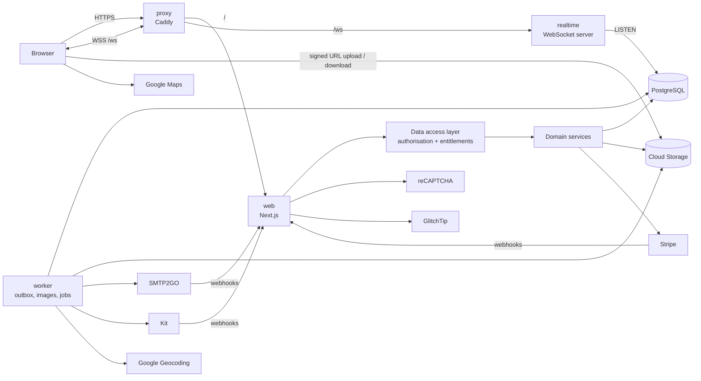

# 01. General Architectural Design

This document describes **how** the platform is built to meet `docs/requirements/01. general_requirements.md`. The module designs are in the other files in this folder: `02` players, `03` organisations, `04` offers, applications and messaging, `05` dashboard, `06` subscriptions. Code layout and tasks belong in `docs/implementation/`. Moving the WordPress data is in `docs/migration/`.

Requirement IDs (GEN-x.y, PLR-x.y, ORG-x.y, OFF-x.y, APP-x.y, MSG-x.y, NOT-x.y, ADM-x.y, SUB-x.y) refer to the requirements files.

---

## 1. Decisions

| Area | Decision |
|---|---|
| Application | One Next.js 16 application (App Router, React Server Components, Server Actions), TypeScript |
| Database | PostgreSQL 16 or newer, accessed through Prisma |
| Real-time chat | A separate WebSocket server (`ws` library) fed by PostgreSQL `LISTEN/NOTIFY` (`04` design) |
| Background work | A worker process for email, image conversion and scheduled jobs |
| Authentication | Better Auth (MIT), email and password only, with sessions stored in the database (section 5) |
| Password hashing | Argon2id; WordPress passwords are kept through hash wrapping (section 5.5) |
| Roles | `PLAYER`, `MANAGER`, `OFFLOAD_ADMIN`, `ADMINISTRATOR`. A manager's type comes from their organisation. |
| Files | Google Cloud Storage, accessed only through signed URLs |
| Payments | Stripe Billing, Stripe Checkout and the Stripe Customer Portal, with one Stripe customer per organisation (`06` design) |
| Transactional email | SMTP2GO |
| Newsletter | Kit |
| Maps and geocoding | Google Maps Platform |
| Bot protection | Google reCAPTCHA v3, plus a honeypot field and rate limits |
| Error tracking | Self-hosted GlitchTip |
| Hosting | One Linux VM on Google Cloud (Compute Engine) in `europe-west2` (London), running everything in Docker Compose. PostgreSQL runs in its own container. |
| Rate limits and caches | PostgreSQL only; no Redis or Valkey |
| Software | Open-source libraries and self-hosted services, except the outside services named in this table |
| Language | English (UK) only in the first release |

Next.js 16 conventions this design relies on:
- request interception lives in `proxy.ts` and is used only for optimistic checks
- dynamic route `params` are Promises
- `cacheComponents: true` is on from the start, which `'use cache'` needs
- `updateTag` works only inside Server Actions, and `revalidateTag` is used from Route Handlers
- Route Handlers cannot hold WebSocket connections, which is why real-time chat runs as a separate process

## 2. Architecture overview



**Principles**
- **One codebase, several processes.** The `web`, `realtime` and `worker` processes share one repository and one database. There are no separate API services, because the required scale does not need them (GEN-10.2).
- **Every read and write goes through the data access layer (DAL).** The DAL loads the signed-in user (the *viewer*), checks role, verification, organisation membership and subscription, and only then reads or writes data. Pages, Server Actions and Route Handlers never use the database client directly (GEN-1.4).
- **`proxy.ts` is not a security boundary.** It only redirects requests without a session cookie and sets security headers.
- **Server Actions handle the app's own forms.** Route Handlers are used only where an outside caller exists: Better Auth's endpoints (`/api/auth/*`), the Stripe, SMTP2GO and Kit webhooks, file access, uploads and the worker's job calls.
- **Side effects go through an outbox (section 9).** Emails, newsletter updates, geocoding, image conversion and real-time events are recorded in the same transaction as the change, so a failed email never loses data and can be retried (GEN-7.6).

## 3. Modules

| Module | Responsibility | Requirements |
|---|---|---|
| `auth` | Better Auth set-up: registration, sign-in, sessions, password reset, email verification, email change, lockout, bot protection | GEN-2 to GEN-4, ADM-1.4, ADM-1.5 |
| `users` | Accounts for every role: roles, suspension, deletion, data export, unverified-account cleanup | GEN-1, GEN-3.8 to GEN-3.11, GEN-9, ADM-7 |
| `verification` | Document submissions, review decisions, claims, revocation | GEN-5, ADM-6 |
| `player-profiles` | Player profile, club history, achievements, videos, players directory | `02` |
| `organisations` | Organisations, manager memberships and claims, leagues, industries, change requests, directories | `03`, ADM-8 |
| `offers` | Offers, expiry, copy, moderation, offers directory | `04` §1, ADM-9 |
| `applications` | Applications and statuses | `04` §2 |
| `messaging` | Conversations, messages, read state, real-time events | `04` §3 |
| `notifications` | In-app notifications and email through the outbox | GEN-7, NOT-1, ADM-4.10, SUB-9 |
| `billing` | Plans, subscriptions, trials, entitlements, Stripe | `06` |
| `files` | Signed uploads, conversion, private access | GEN-8 |
| `reference` | Countries, positions, skills, qualifications, leagues, industries | PLR-11.1, ADM-11.1 |
| `dashboard` | Role-aware dashboard and staff sections | `05` |
| `audit` | Audit log | ADM-12, GEN-10.1 |
| `content` | Static pages (home, about, pricing text, legal pages) kept in code | GEN-6.4, GEN-6.5, ADM-13.3 |

Dependencies point one way: pages and actions → DAL → services → database and outside services. A module uses another module only through that module's service functions.

## 4. Domain model overview

```mermaid
erDiagram
  USER ||--o| PLAYER_PROFILE : has
  USER ||--o{ SESSION : has
  USER ||--o| ACCOUNT : "signs in with"
  USER ||--o{ VERIFICATION_REQUEST : submits
  VERIFICATION_REQUEST ||--o{ VERIFICATION_DOCUMENT : has
  USER ||--o| ORGANISATION_MEMBER : "is"
  ORGANISATION ||--o{ ORGANISATION_MEMBER : has
  ORGANISATION ||--o{ OFFER : publishes
  ORGANISATION ||--o{ SUBSCRIPTION : has
  ORGANISATION ||--o{ COACH : has
  ORGANISATION ||--o{ SEASON : has
  ORGANISATION ||--o{ TRAINING_SESSION : has
  ORGANISATION }o--o{ LEAGUE : "plays in"
  ORGANISATION ||--o{ ORGANISATION_CHANGE_REQUEST : has
  PLAYER_PROFILE ||--o{ CLUB_HISTORY : has
  PLAYER_PROFILE ||--o{ ACHIEVEMENT : has
  PLAYER_PROFILE ||--o{ FEATURED_VIDEO : has
  PLAYER_PROFILE ||--o{ APPLICATION : makes
  OFFER ||--o{ APPLICATION : receives
  CONVERSATION ||--o{ CONVERSATION_PARTY : has
  CONVERSATION ||--o{ MESSAGE : contains
  USER ||--o{ NOTIFICATION : receives
  SUBSCRIPTION ||--o{ PAYMENT : has
  PLAN ||--o{ SUBSCRIPTION : "priced by"
  USER ||--o{ FILE : owns
```



The entities of each module are defined in files `02` to `06`. Shared entities (users, accounts, sessions, tokens, files, notifications, outbox, settings) are defined here.

**Conventions**
- **Keys:** primary keys are UUIDv7 (`@id @default(uuid(7)) @db.Uuid`). They are time-ordered, so new rows go to the end of the index. Every foreign key is `@db.Uuid` too. Better Auth is set to generate the same UUIDv7 ids for its tables. Tables keyed by a natural value keep it, for example `Country.code`, reference-data slugs and the Stripe event id.
- **Timestamps and actors:** every table has `createdAt`, `updatedAt`, `createdById` and `updatedById`. Append-only tables (audit events, messages, Stripe webhook events, sent billing reminders) have only `createdAt` and `createdById`; audit events call it `actorId`.
  - The actor columns are nullable foreign keys to `User`, so a deleted user still shows as "Deleted user".
  - A person's change stores their user id. A change made by a job, a webhook or the migration stores `null`, and screens show it as "System". There is no system user row and no system account.
  - The audit log records which part of the system acted (`05` design section 10).
  - The actor is set once per request or job. A Prisma client extension fills both columns from it on every create and update, so no service can forget them.
  - These columns show the last editor only. The audit log keeps the full before-and-after history (`05` design section 10).
  - Fields with a business meaning keep their own names, for example `Subscription.purchasedById`.
- **Boolean fields:** named as a yes/no question, starting with `is` (for example `isActive`, `isHidden`) or `has` where the record owns something (`hasAcademicInterest`). Where the date also matters, a nullable timestamp is used instead of a Boolean, for example `listedAt`, `deletedAt` and `emailVerifiedAt`.
- **Enums vs tables:** fixed states (roles, statuses) are Prisma enums. Lists that staff edit (positions, skills, qualifications, leagues, industries) are tables with an `isActive` flag (PLR-11.1, ADM-11.1).
- **Reserved values:** enum values and fields can be added before they are used. Examples are `BANNED` for organisations (ORG-12.1) and the player `isHidden` flag (PLR-10.1).
- **Files:** other tables store only the `File` id as a foreign key, never a URL or a bucket path (section 8.1).
- **Arrays vs join tables:** a PostgreSQL array is used only for a short list of fixed codes that are never deleted, such as ISO country codes in `User.nationalities`. The values are checked by the validation schema and searched through a GIN index. A list that points at rows that can change or be deleted (files, plans, reference data) uses a join table with foreign keys.
- **Deletion:** users and organisations are never removed as rows. Deleting one turns it into an anonymised *tombstone*, so messages, applications, payments and audit events still point at a valid row, shown as "Deleted user" or "Deleted organisation" (GEN-9.3, MSG-1.12, ADM-7.5, ADM-8.7, ADM-12.6).
- **WordPress ids:** every imported table has a nullable, unique `legacyId` column for the migration.

## 5. Identity, sessions and passwords

### 5.1 User

```prisma
enum UserRole   { PLAYER  MANAGER  OFFLOAD_ADMIN  ADMINISTRATOR }
enum UserStatus { ACTIVE  SUSPENDED  DELETED }
enum DocumentStatus { NONE  AWAITING_REVIEW  VERIFIED  REJECTED  REVOKED }

model User {
  id                 String @id @default(uuid(7)) @db.Uuid
  email              String @unique            // stored lower-case; compared case-insensitively (GEN-2.2)
  isEmailVerified    Boolean @default(false)   // Better Auth's `emailVerified` field
  emailVerifiedAt    DateTime?                 // set together with isEmailVerified (GEN-5.1)
  pendingEmail       String?                   // shown in account settings while a change waits for verification (ADM-1.5)
  name               String?                   // Better Auth's display name: first and last name, kept in step
  role               UserRole
  previousRole       UserRole?                 // role before becoming staff, to return to it (ADM-4.2)
  status             UserStatus @default(ACTIVE)
  firstName          String?                   // null only on a deleted tombstone
  lastName           String?
  dateOfBirth        DateTime? @db.Date        // required at registration (GEN-2.2); null for staff
  nationalities      String[]  @db.Char(2)     // one or more ISO 3166-1 alpha-2 codes; GIN index
  personalPhone      String?
  bio                String?   @db.VarChar(2000)
  profilePictureId   String?   @db.Uuid        // File
  documentStatus     DocumentStatus @default(NONE)
  documentDecidedAt  DateTime?
  documentDecidedById String?  @db.Uuid
  termsVersion       String
  termsAcceptedAt    DateTime
  isNewsletterOptedIn Boolean @default(false)
  failedLogins       Int @default(0)
  lockedUntil        DateTime?
  unverifiedReminderStage Int @default(0)      // 0 none, 1 = 30-day notice sent, 2 = 7-day notice sent (GEN-3.9)
  lastSeenAt         DateTime?
  legacyId           String? @unique
  legacyRegisteredAt DateTime?                 // original WordPress registration date
  createdAt          DateTime @default(now())  // for imported users: the migration date (GEN-3.10 clock)
  updatedAt          DateTime @updatedAt
  createdById        String?  @db.Uuid         // null = created by the system (registration, migration)
  updatedById        String?  @db.Uuid
}

// Better Auth's account table: holds the password for email-and-password sign-in
model Account {
  id         String @id @default(uuid(7)) @db.Uuid
  userId     String @unique @db.Uuid
  accountId  String                          // the user id, as Better Auth requires
  providerId String                          // always "credential"; no social sign-in in the first release
  password   String?                         // Argon2id hash, or a wrapped WordPress hash (section 5.5)
  // createdAt, updatedAt, createdById, updatedById
}
```

- **Better Auth fields:** Better Auth's core user fields are mapped onto `User` with its field-name options. Its `emailVerified` field is `isEmailVerified`, and `name` is kept in step with `firstName` and `lastName`. The platform's own fields (`role`, `status`, `documentStatus` and the rest) are declared as Better Auth additional fields that users cannot set through its endpoints. Only services change them.
- **Shared fields:** players and managers share the fields on `User`: name, date of birth, nationalities, phone, bio, profile picture and document status. Only player-specific fields live on `PlayerProfile` (`02` design).
- **Verified user (GEN-5.5):** `emailVerifiedAt` is set and `documentStatus = VERIFIED`. Staff are treated as verified (ADM-4.4).
- **Unverified account (GEN-3.8):** `emailVerifiedAt` is null and `documentStatus` is not `VERIFIED`, for a non-staff user.
- **Separate decisions:** email verification and document verification are stored separately, each with its date. Document decisions also record the staff member who decided (GEN-5.1).

### 5.2 Sessions

Sessions are handled by Better Auth with its database session store.

- **Storage:** Better Auth's `Session` table has `id`, `userId`, `token`, `expiresAt`, `ipAddress` and `userAgent`, plus the standard timestamp and actor columns.
- **Cookie:** Better Auth's session cookie is `HttpOnly`, `Secure` and `SameSite=Lax`, with path `/`. Its cookie cache is turned off, so every request reads the session from the database and an ended session stops working at once.
- **On each request:** the server reads the session and the user through Better Auth. The session is refused if it has expired or the user is not `ACTIVE`. The lookup runs once per request and its result is reused for the rest of that request (React `cache()`).
- **Expiry (GEN-4.6):** `expiresIn` is 365 days and `updateAge` is 1 hour. Each visit moves the expiry to 365 days after that visit, writing to the database at most once an hour. This applies to every user, staff included.
- **Ending sessions:**
  - Sign out deletes the current session.
  - "Sign out of all devices" (GEN-4.7) deletes every session of the user.
  - A password reset deletes all other sessions (GEN-4.5).
  - Suspension, deletion and a role change delete all sessions of the user.
- **Real-time connections:** the realtime server checks the session cookie against the `Session` table when a connection opens, and is told to close the user's connections whenever their sessions end (`04` design).

### 5.3 Tokens

| Token | Lifetime | Handled by | Use |
|---|---|---|---|
| Email verification | 48 hours | Better Auth | GEN-3.1 to GEN-3.4 |
| New email verification | 48 hours | Better Auth change-email flow | ADM-1.5 |
| Password reset | 1 hour, single use | Better Auth (`Verification` table) | GEN-4.4 |
| Staff invitation | 7 days, single use | Platform `Token` table | ADM-4.4 |

- Better Auth stores its own tokens in its `Verification` table. Lifetimes are set in its configuration.
- The platform's `Token` table, used only for staff invitations, has `type`, `userId`, `tokenHash`, `expiresAt` and `usedAt`. Only the hash is stored.

### 5.4 Registration, sign-in and verification flows

- **Registration (GEN-2.1 to GEN-2.10):**
  - One registration flow with a role choice. How it is split into steps is an implementation detail.
  - The validation schema enforces the password rules (8 to 50 characters, one uppercase letter, one lowercase letter, one number and one symbol). The same rules drive the live checklist shown while typing (GEN-2.3).
  - A Server Action calls Better Auth's sign-up. A database hook creates the profile in the same transaction: a `PlayerProfile` for players, or an organisation membership for managers (`03` design).
  - The verification email is sent through the outbox, and also attempted at once after commit. The user then sees "Check your email" (GEN-2.8).
- **Bot protection (GEN-2.10):**
  - **reCAPTCHA v3:** Better Auth's captcha plugin checks a Google reCAPTCHA v3 token on sign-up, sign-in and password reset, with a minimum score of 0.5. The contact form (`05` design section 11) uses the same check. A low score refuses the request with "Please try again". If Google cannot be reached, the plugin refuses the request; the rate limits still apply.
  - **Honeypot:** a hidden field on the same forms. A filled-in field refuses the request without saying why.
  - **Rate limits:** per IP address and per email (section 13).
  - The reCAPTCHA script loads only on these four forms (section 14.3).
- **Sign-in:**
  - Failures show one generic message (GEN-4.2).
  - **Lockout (GEN-4.3):** Better Auth has no lockout, so a hook adds it. After 5 failures within 15 minutes the account is locked for 15 minutes (`failedLogins`, `lockedUntil`), and the user is told. A hook before sign-in refuses a locked account; a hook after sign-in counts failures and resets them on success.
  - While the email is unverified, every sign-in shows a "Verify your email" dialog with "send a new link". The user can close it (GEN-3.12).
- **Email change (ADM-1.5):**
  - Better Auth's change-email flow sends a verification link to the new address. The platform also stores the new address in `pendingEmail`, so account settings can show it.
  - `email` changes only when that link is used, and `pendingEmail` is then cleared. Until then the old address stays the account email, and verification-based rights are kept.
- **Unverified accounts (GEN-3.9 to GEN-3.11):** a daily job finds unverified non-staff accounts by age, counted from `createdAt`.
  - At 150 days it sends the 30-day notice, and at 173 days the 7-day notice.
  - At 180 days it deletes the account (section 14.2). A manager's organisation is deleted with them if it is not Published.

### 5.5 Passwords

- **Algorithm:** Argon2id with at least 19 MiB of memory, 2 passes and 1 thread (the OWASP minimum), through `@node-rs/argon2` (MIT). Better Auth's `password.hash` and `password.verify` options are set to these functions.
- **Scheme prefix:** every stored hash starts with its scheme, so the verifier picks the algorithm from the prefix and the algorithm or its settings can change later. A hash with outdated settings is replaced on the next successful sign-in.
- **WordPress passwords (hash wrapping):** every WordPress account uses the old phpass hash, which is MD5-based and weak. Users keep their passwords without a reset:
  1. **Migration:** each phpass hash is hashed again with Argon2id and stored as `wp-phpass$<phpass salt and settings>$<Argon2id hash>`. No weak hash is ever stored, even for users who never come back.
  2. **Sign-in:** the verifier computes the phpass hash of the typed password with the stored salt and settings, then checks it against the Argon2id part.
  3. **Upgrade:** after a successful sign-in, a hook replaces the wrapped value with a plain Argon2id hash of the password.
  4. **Password rules:** the new rules (GEN-2.3) are not forced on existing passwords. They apply at the next password change.

## 6. Roles and authorisation

### 6.1 The viewer

`getViewer()` returns `null` for visitors, or `{ user, role, verified, membership?, organisation?, entitlements, isStaff, permissions }`. It is worked out once per request and the result is reused for the rest of that request.
- `membership` is the manager's organisation membership (`03` design).
- `entitlements.subscription` is the result of `hasActiveSubscription(organisationId)` (`06` design).
- `permissions` is the staff permission set (`05` design).

### 6.2 Policies

Policies are plain functions on the viewer, used by pages, Server Actions and Route Handlers alike (GEN-1.4). Examples:

| Policy | Rule |
|---|---|
| `canViewPlayers` | Staff; or a verified player; or a manager whose organisation has an active subscription (PLR-9.1) |
| `canMessage` | Staff; or a verified user (GEN-5.5, MSG-1.1) |
| `canApply` | A verified player, the offer Published and not expired (APP-1.3) |
| `canManageOffers` | An active membership, a verified manager and an active subscription (OFF-1.1) |
| `canViewApplications` | An active membership, a verified manager and an active subscription (APP-1.5) |
| `canEditOrganisation` | See `03` design section 4 (ORG-7.1) |
| `canBuyPlan` | A verified manager, an active membership and a Published organisation (SUB-4.1) |
| `hasPermission(p)` | Staff permission check (`05` design) |

Pages render one of three gate components:
- `LoginRequired`: "You need to be logged in", with a return link (GEN-6.2).
- `SubscriptionRequired`: "You need to be subscribed…", with a link to the plans (SUB-3.6).
- `VerificationRequired`: what is missing for verification (PLR-1.3, ADM-1.6).

### 6.3 Access matrix (GEN-6.1)

| Area | Visitor | Player not verified | Verified player | Manager, no subscription | Manager, subscribed | Staff |
|---|---|---|---|---|---|---|
| Public pages, single organisation page | ✓ | ✓ | ✓ | ✓ | ✓ | ✓ |
| Organisation directories, offers directory, offer page | login gate | ✓ | ✓ | ✓ | ✓ | ✓ |
| Players directory, player profile | login gate | verification gate | ✓ | subscription gate | ✓ | ✓ |
| Apply to an offer | – | – | ✓ | – | – | – |
| Send messages | – | – | ✓ | verified only | verified only | ✓ |
| Manage offers, view applications | – | – | – | subscription gate | own organisation | moderation only |
| Dashboard | login redirect | own | own | own | own | own and staff sections |

## 7. Request flows

**Gated page:**
1. `proxy.ts` sees no session cookie and redirects to `/login?next=…`.
2. With a cookie, the page renders, calls `getViewer()`, then the policy.
3. It shows either a gate component or the data.

**Mutation (Server Action):**
1. Parse the form with a validation schema.
2. Call `getViewer()`, then the policy.
3. Run the service in a database transaction, which writes the change, audit events and outbox rows together.
4. Commit, update cache tags, and return the result or field errors.

## 8. Files and media

### 8.1 Storage

- **Buckets:** three Cloud Storage buckets in `europe-west2`, all with public access prevention and uniform bucket-level access:
  - `offload-uploads`: a short-lived landing area for raw uploads. A lifecycle rule deletes objects after 1 day.
  - `offload-user-content`: the finished files the platform serves, under `public/` (WebP images) and `private/` (identity documents, organisation documents, CVs, exports).
  - `offload-backups`: database backups (section 16.2). The application has no access to it.
- **`File` table:** records `bucket`, `key`, `purpose`, `mimeType`, `size`, `ownerId`, `status` (`PENDING`, `READY`, `REJECTED`) and the WebP `variants`.
- **Only the id is stored elsewhere:** other tables point at a file by its `File` id, for example `User.profilePictureId`. They never store a URL or a path.
  - Signed URLs expire and act as credentials, so they are created only at the moment of reading and never saved.
  - The location lives in one row, so files can be moved or the key format changed without touching other tables.
- **Object keys:** built from ids only, never from the user's file name, for example `public/{fileId}/{variant}.webp` and `private/{fileId}.pdf`. Original file names can contain personal details, so they are not stored.

### 8.2 Uploads (GEN-8.1, GEN-8.2)

1. The browser asks a Server Action for an upload. The action checks the session, the purpose and the user's right to upload for it.
2. The action returns a **V4 signed `PUT` URL**, valid 10 minutes, for one new object in `offload-uploads`. The signature fixes the content type and an `x-goog-content-length-range` header with the size limit from GEN-8.1, so Cloud Storage refuses a wrong type or an oversized file.
3. The browser uploads directly, then calls "upload complete".
4. The worker processes the file:
   - It reads the first bytes to check the real file type. The declared type and the extension are not trusted.
   - It rejects SVG files (GEN-8.6) and any file that does not match the allowed formats for its purpose.
   - It converts every image (JPEG, PNG, WebP, HEIC, AVIF), including images uploaded as documents, to WebP and strips metadata such as GPS location (GEN-8.5).
   - Public images get display variants: avatar 128 px, card 400 px, header 1,200 px (GEN-8.4). Document images get one full-size, high-quality WebP so staff can read them.
   - PDFs are kept as they are.
   - It writes the result to `offload-user-content` and deletes the uploaded original.
5. A rejected file is deleted and the user is told why, with the accepted formats and limit.

### 8.3 Reading files

- **Images:** a Route Handler `/media/{fileId}/{variant}` checks who may see the image, then redirects to a signed `GET` URL valid 1 hour. The redirect can be cached for 50 minutes, so cached pages keep stable image addresses.
  - Organisation logos and coach images are visible to everyone.
  - Profile pictures are visible to signed-in users only.
- **Private files:** a Route Handler `/files/{id}` checks the policy first:
  - Identity and organisation documents: the owner and staff (GEN-8.3).
  - CVs: the player, staff and managers with an active subscription (`02` section 2.7).

  It writes an audit event for every opening of an identity document. It then redirects to a signed URL valid 5 minutes, with `Cache-Control: private, no-store`.
- **Placeholders:** every image a user can upload (profile picture, logo, coach image) has a default placeholder image, shown wherever the image is missing.

### 8.4 Access to Cloud Storage

- **Application account:** the `web` and `worker` services use the VM's attached service account, so there is no key file on the VM. It has object create, read and delete rights on `offload-uploads` and `offload-user-content` only, plus the right to sign URLs (Service Account Token Creator on itself).
- **Backup account:** the `backup` service uses a separate service account with rights on `offload-backups` only. Its key is mounted into the `backup` container alone.
- **CORS:** the bucket rules allow `PUT` and `GET` only from the site's own domain.

## 9. Notifications, email and the outbox

- **In-app notifications:**
  - The `Notification` table has `userId`, `type`, a link to the related item, `createdAt` and `readAt`. Each notification shows its event type, the name or title of the linked item and the time.
  - The navigation shows the unread count, including "0" (GEN-7.2).
  - Opening the notification panel sets `readAt` on all notifications in it (GEN-7.3).
- **Outbox:** the `OutboxMessage` table has `type`, `payload`, `status`, `attempts`, `nextAttemptAt` and `lastError`. Services insert outbox rows in the same transaction as the change.
- **Worker:** the worker processes outbox rows continuously: emails, newsletter add/remove, geocoding, image conversion and data exports.
  - Retries use exponential backoff, up to 8 attempts.
  - Repeated failures raise a staff alert (GEN-10.8).
- **Urgent emails:** verification and password-reset emails are also attempted straight after commit, using Next.js `after()`. If that attempt fails, the page says so and offers "try again" (GEN-7.6).
- **Templates and delivery:** email templates are React components rendered to HTML and plain text. Every notification email in GEN-7.1 is always sent, with no opt-out (GEN-7.4).
- **Organisation recipients:** every message to an organisation goes to every verified manager of that organisation (ORG-1.4), through one helper, `managersToNotify(organisationId)`.
- **Transactional email (SMTP2GO):**
  - The worker sends through SMTP2GO's API, from the sender set in settings (`05` design section 11).
  - The sending domain has SPF, DKIM and DMARC records for SMTP2GO.
  - SMTP2GO's bounce and spam-complaint webhooks (`/api/webhooks/smtp2go`, checked with a shared secret) mark the address as undeliverable and alert staff. Urgent emails to such an address show a message asking the user to check it.
- **Newsletter (GEN-7.5, Kit):**
  - Opting in or out at registration or in account settings queues an add or unsubscribe call to Kit's API (v4).
  - Kit's unsubscribe link flows back through Kit's unsubscribe webhook (`/api/webhooks/kit`), which sets `isNewsletterOptedIn = false`. A daily job also reads Kit's unsubscribed list, in case a webhook was missed or the plan does not include webhooks.
  - The newsletter itself is written and sent by staff in Kit.
- **Staff alerts (ADM-4.10):** each new item waiting for review notifies every staff member by email and in the app. A daily job sends a summary of everything still waiting.

## 10. Scheduled jobs

The `worker` runs a fixed schedule. Each job is idempotent, so running it twice does no harm.

| Job | When | Purpose |
|---|---|---|
| Offer expiry | hourly | Expire offers, send "expires in 3 days" and "expired" notices (OFF-1.5, NOT-1.1) |
| Unverified accounts | daily | 30-day and 7-day notices, deletion at 180 days (GEN-3.9 to GEN-3.11) |
| Staff summary | daily | Summary of items waiting for review (ADM-4.10) |
| Billing | daily, 09:00 UK time | End trials, end grace periods (SUB-6.3), trial-ending, annual-renewal and subscribe-again reminders (SUB-2.4, SUB-6.9, SUB-6.10) (`06` design section 5.7) |
| Billing reconciliation | daily | Compare local subscriptions with Stripe (`06` design section 9.3) |
| Billing retention | yearly | Delete billing records older than 6 years (SUB-10.2) |
| Audit retention | daily | Delete audit events past their retention period (ADM-12.5) |
| Newsletter sync | daily | Read Kit's unsubscribed list and clear `isNewsletterOptedIn` (GEN-7.5) |
| Cleanup | daily | Expired sessions and tokens, abandoned uploads, expired export files |

## 11. Search and directories

- **No separate search engine:** PostgreSQL alone is enough at the required scale (GEN-10.2).
- **Name and title search:** uses the `pg_trgm` and `unaccent` extensions, so it ignores case and accents. Searches match names and titles only (PLR-9.3, ORG-8.3, OFF-2.3).
- **Filters:** use indexed columns, or `EXISTS` sub-queries on join tables with indexes.
- **Paging:** cursor (keyset) paging on `(sortKey, id)`, 24 results at a time. Totals are counted separately.
- **Infinite loading:** the players directory and the organisation directories load the next 24 results when the visitor scrolls near the end of the list. The cursor is kept in the URL, so the back button returns to the same place, and a "Load more" button is shown as a fallback when scrolling cannot trigger it. Staff lists keep page-by-page paging.
- **Filters in the URL:** the filter state is kept in the URL, so results can be shared and the back button works. Values that fail validation are dropped.
- **Global search (GEN-6.3):** for signed-in users, one search box queries clubs, unions, colleges/universities, brands and offers by name or title, and groups the results by type.

## 12. Caching and rendering

- **Public pages:** home, about, pricing, legal pages and single organisation pages are cached with `'use cache'` and cache tags. Editing an organisation updates its tag, so the change shows at once.
- **Personalised pages:** gated and personalised pages render per request. Player data is never put in a shared cache.
- **Personal parts of cached pages:** the "Message" button and the players list are rendered in small dynamic components inside the cached page.
- **SEO (GEN-10.5):** public pages have titles, descriptions and Open Graph data, and appear in `sitemap.xml`. Login-gated pages send `noindex` and are kept out of the sitemap.

## 13. Security

- **Secrets:** stored only in environment variables on the VM. The application refuses to start if a required secret is missing.
- **Input validation:** a validation schema runs at every Server Action and Route Handler.
- **Request origin:** Server Actions use the built-in Next.js origin check. Route Handlers that change data check a signature (Stripe), a shared secret (worker job calls) or the `Origin` header.
- **Security headers:** set by `proxy.ts` and Caddy: Content-Security-Policy, HSTS, `X-Content-Type-Options`, `Referrer-Policy` and `frame-ancestors 'none'`. HTTPS only (GEN-10.1).
- **Rate limits (GEN-10.1, GEN-3.4, MSG-1.10):** sliding windows per IP and per account on sign-in, registration, password reset, verification resend, messaging, upload and contact-form requests. Counters are kept in one PostgreSQL table, with no Redis. Better Auth uses the same table through its custom rate-limit storage, so its endpoints and the platform's own actions share one store.
- **Outside webhooks:** Stripe is checked by its signature; SMTP2GO and Kit by a shared secret in the webhook URL or header.
- **Outside keys:** the Google Maps browser key is restricted to the site's domain and to the Maps JavaScript API. The geocoding key is a separate server key restricted to the VM's IP address and the Geocoding API.
- **Audit log:** written in the same transaction as the change (`05` design).
- **Logs:** never include emails, tokens, document names or message bodies.

## 14. Privacy

### 14.1 Data export (GEN-9.2)

A worker job builds the user's data as JSON, plus their files, into a zip file in `offload-user-content/private/exports/`. The user receives a signed URL valid 24 hours. The cleanup job deletes the zip after 7 days.

### 14.2 Account deletion (GEN-9.2, GEN-9.3)

One service, `deleteAccount(userId)`, handles self-deletion, deletion by staff and unverified-account deletion. It runs in one transaction:
1. **Guards:** it refuses to delete the last verified manager of an organisation (ORG-1.8) and the last Administrator (ADM-4.3).
2. **Messages:** kept. The sender now shows as "Deleted user" (MSG-1.12).
3. **Applications:** withdrawn and shown as "Deleted user" (ADM-7.5).
4. **Memberships:** ended. A manager's own organisation is deleted with them if it is not Published (GEN-3.11, `03` design).
5. **Files:** deleted, together with the profile, sessions, tokens and notifications.
6. **Audit events:** kept by id only, with name and email removed (ADM-12.6).
7. **The user row:** becomes a tombstone. Status is `DELETED`, personal fields are cleared, the email is replaced by a unique placeholder and the password is removed.
8. **Billing records:** kept with the organisation (SUB-10.2).
9. **Newsletter:** the provider is told to remove the address.

### 14.3 Cookie consent (GEN-9.4)

The site shows a cookie consent banner, as UK GDPR and PECR require for non-essential cookies.

- **Banner:** shown on the first visit, with "Accept all", "Reject non-essential" and "Choose", given equal weight. Nothing non-essential loads before a choice. A "Cookie settings" link in the footer reopens it at any time.
- **Categories:**

| Category | Contents | Default |
|---|---|---|
| Essential | Session cookie, security cookies, the consent cookie itself, and Google reCAPTCHA v3 on sign-up, sign-in, password reset and the contact form | Always on |
| Maps | Google Maps on organisation and offer pages (ORG-9.2, OFF-2.4) | Off until accepted |
| Analytics | None in the first release; ready for later | Off until accepted |

- **reCAPTCHA:** essential. The four protected forms cannot work without it, because a request without a valid reCAPTCHA check is refused (section 5.4). It loads only on those forms, never elsewhere, and the banner does not let it be switched off. The cookie policy names it and links to Google's privacy policy.
- **Maps without consent:** organisation and offer pages show the address as text and a placeholder with "Show map", which accepts the Maps category.
- **Storing the choice:** a first-party cookie holds the chosen categories, the policy version and the date, kept for 12 months. The banner asks again when the policy version changes or the cookie expires. For signed-in users the same choice is also saved in a `CookieConsent` table (user, categories, policy version, date) as a record of consent.
- **Library:** an open-source consent banner, for example `vanilla-cookieconsent` (MIT), styled to the site. Scripts in a category load only when that category is accepted.
- **Cookie policy page:** lists every cookie and outside service by category. It is part of the legal pages (GEN-6.5).

## 15. Language

- The first release is English (UK) only (GEN-10.9). Dates are shown as DD/MM/YYYY through one helper, `formatDate`, built on `Intl.DateTimeFormat('en-GB')`. They are stored in UTC.
- **Later releases (GEN-11):** automatic translation, a user language setting and localised dates. The single date helper and the server-rendered pages keep that change small. No translation layer is built now.

## 16. Deployment

### 16.1 Hosting

One Linux VM on Google Cloud Compute Engine runs every service in **Docker Compose**. The same Compose file, with a development override, runs on developers' machines and on a smaller staging VM.

| Service | Image | Notes |
|---|---|---|
| `proxy` | Caddy (automatic Let's Encrypt certificates) | Only service that publishes ports (80, 443). Routes `/ws` to `realtime`, the rest to `web`. Blocks `/api/jobs/*` from outside. |
| `web` | built from the repository (`next start`) | Internal network only |
| `realtime` | built from the repository | Internal network only |
| `worker` | built from the repository | No port. Runs the outbox and the job schedule; calls `web` at `http://web:3000/api/jobs/{job}` with a shared secret where a job needs web code. |
| `db` | PostgreSQL 16 or newer, image tag pinned to the major version | Internal network only; data in the `pgdata` volume |
| `backup` | pgBackRest | Continuous WAL archiving and a nightly base backup to Cloud Storage, with its own service account (section 8.4) |
| `glitchtip` | GlitchTip, image tag pinned | Error tracking. One service (web and worker together) using its own database in `db` and no Valkey. Reached through `proxy` on its own subdomain, for staff only. |

- **Network:** only `proxy` publishes ports. Docker's published ports bypass the VM firewall, so no other service publishes one. The Google Cloud firewall allows 80, 443 and SSH (keys only, and restricted to known IP addresses where possible).
- **Volumes:** `pgdata` and `caddy_data` live on the VM's persistent disk. Uploaded files are in Cloud Storage, not on the VM.
- **Restarts:** every service uses `restart: unless-stopped` and has a health check. `web`, `realtime` and `worker` start only after `db` is healthy.
- **Secrets:** kept in an `.env` file on the VM that only the deploy user can read, never in images.
- **Database upgrades:** PostgreSQL major-version upgrades are planned (dump and restore, or `pg_upgrade`). They never happen by changing the image tag alone.
- **Region:** the VM and every bucket are in `europe-west2` (London), so the data stays in the UK.
- **Sizing:** 2 vCPU, 4 GB RAM and a 30 GB disk at the current scale, growing the disk as the database grows. GlitchTip shares the VM, so memory use is checked after launch and the VM moves to 8 GB if it runs short.

### 16.2 Backups (GEN-10.7)

- **Database:** pgBackRest writes continuous WAL archives and a nightly base backup to the `offload-backups` bucket, kept 14 days. This allows restoring to any point in the last 7 days.
- **Files:** object versioning on `offload-user-content`. Older versions are kept 14 days, so deleted or overwritten files can be restored.
- **Snapshots:** weekly Compute Engine snapshots of the VM disk, as an extra safety net.
- **Restore test:** at least once a month, on a spare VM.
- **Alternatives not chosen:** disk snapshots alone restore only to the time of a snapshot, not to any point (GEN-10.7). Cloud SQL would handle backups itself but costs more each month than PostgreSQL on the VM.

### 16.3 Deploys

CI builds the `web`, `realtime` and `worker` images and pushes them to a container registry. On the VM:
1. `docker compose pull`
2. Run the database migrations in a one-off `web` container.
3. `docker compose up -d`

Browsers reconnect to the realtime server by themselves.

## 17. Observability

- **Logs:** structured, with a request id, collected through Docker logging.
- **Error tracking:** self-hosted GlitchTip, which accepts the Sentry SDK. `web`, `realtime` and `worker` send errors to it. Events are scrubbed of emails, tokens, cookies and message bodies before they leave the process.
- **Health and uptime:** a health endpoint (`/api/health`) checks the database. An outside uptime check watches the home page and the health endpoint (GEN-10.6).
- **Alerts (GEN-10.8):** repeated email failures, Stripe webhook failures, job failures, low disk space and error-rate spikes.

## 18. Requirement coverage

| Requirement | Design element |
|---|---|
| GEN-1.1 to GEN-1.4 | Roles (5.1), one membership per manager (`03`), DAL and policies (6) |
| GEN-2.1 to GEN-2.10 | Registration flow and bot protection (5.4) |
| GEN-3.1 to GEN-3.7, GEN-3.12 | Tokens (5.3), sign-in prompt (5.4), policies (6.2) |
| GEN-3.8 to GEN-3.11 | Unverified-accounts job (5.4, 10), account deletion (14.2) |
| GEN-4.1 to GEN-4.7 | Sessions (5.2), lockout (5.4), tokens (5.3) |
| GEN-5.1 to GEN-5.5 | `User` verification fields (5.1), verification module (`05`), policies (6.2) |
| GEN-6.1 to GEN-6.6 | Access matrix (6.3), gates (6.2), global search (11), static content (3) |
| GEN-7.1 to GEN-7.6 | Notifications and outbox (9) |
| GEN-8.1 to GEN-8.6 | Files (8) |
| GEN-9.1 to GEN-9.7 | Privacy (14), cookie consent (14.3) |
| GEN-10.1 to GEN-10.9 | Security (13), search (11), caching and SEO (12), deployment and backups (16), observability (17), language (15) |

## 19. Design questions

None at the moment.

**Deferred to a later release**
- Malware scanning of uploaded documents with a ClamAV container (about 1 GB of memory).
