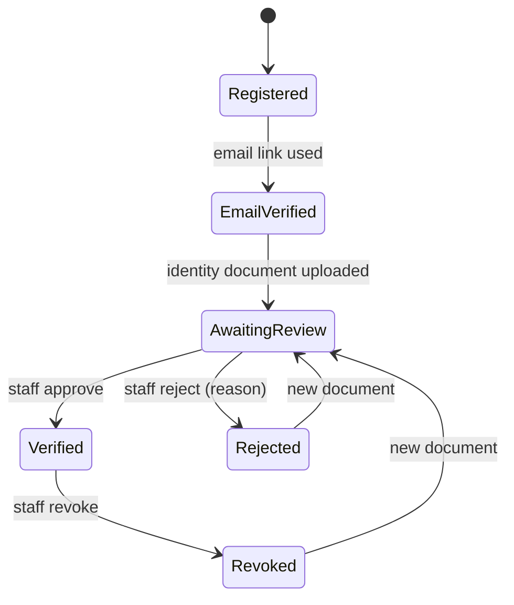

# 02. Player Module Design

Implements `docs/requirements/02. player.md`. Shared parts are in `01. general_design.md`: the `User` model, verification fields, policies, files and search.

---

## 1. Data model

Fields shared with managers are on `User` (`01` design section 5.1): first and last name, date of birth, nationalities (one or more), personal phone, bio, profile picture, email and document verification, terms and newsletter. `PlayerProfile` holds only the player-specific fields.

```prisma
enum RugbyCode { LEAGUE_ONLY  UNION_ONLY  BOTH }
enum AgeGroup  { U16  U18  U20  SENIOR  SEVENS }
enum CountryKind { ELIGIBLE  CAPPED }

model PlayerProfile {
  id        String @id @default(uuid(7)) @db.Uuid
  userId    String @unique

  // Playing information (section 2.2)
  primaryPositionId    String?
  secondaryPositionId  String?
  otherPositionId      String?
  heightCm             Int?                     // 100 to 230
  weightKg             Int?                     // 30 to 200
  currentClubId        String?                  // platform club, or
  currentClubText      String?                  //   typed name (only one of the two is set)
  currentUnionId       String?
  currentUnionText     String?
  currentInstitutionId   String?                // college or university (InstitutionKind, `03` design)
  currentInstitutionText String?
  contractEndDate      DateTime? @db.Date
  rugbyCode            RugbyCode?
  highestQualification String?
  isKeenToRelocate     Boolean @default(false)
  isRetired            Boolean @default(false)
  isOpenToBrandPartnership Boolean @default(false)
  strengths            String? @db.VarChar(500)
  workOns              String? @db.VarChar(500)
  colourPersonality    String?

  // Eligibility and caps (section 2.3)
  isCapped   Boolean   @default(false)
  firstCap   DateTime? @db.Date
  lastCap    DateTime? @db.Date
  totalCaps  Int?

  // Strength and conditioning (section 2.4)
  maxSpeedMs   Decimal? @db.Decimal(5,2)
  broadJumpCm  Decimal? @db.Decimal(6,1)
  test1200Sec  Decimal? @db.Decimal(6,1)
  cmjCm        Decimal? @db.Decimal(5,1)
  bench1rmKg   Decimal? @db.Decimal(5,1)
  squat1rmKg   Decimal? @db.Decimal(5,1)

  // Academic (section 2.5)
  hasAcademicInterest Boolean @default(false)
  isGraduated         Boolean @default(false)

  // Videos and documents (section 2.7)
  highlightVideoUrl String?
  cvFileId          String?                     // private File, PDF

  // Social links (section 2.8), stored as canonical URLs
  instagramUrl String?
  youtubeUrl   String?
  linkedinUrl  String?
  facebookUrl  String?
  xUrl         String?

  // Directory
  listedAt  DateTime?    // set when the player becomes verified; null while not verified
  isHidden  Boolean @default(false)   // reserved for a later "hide me" option (PLR-10.1); always false now

  legacyId  String? @unique

  countries      PlayerCountry[]
  ageGroups      PlayerAgeGroup[]
  qualifications PlayerQualification[]
  skills         PlayerSkill[]
  clubHistory    ClubHistory[]
  achievements   Achievement[]
  featuredVideos FeaturedVideo[]
}

model PlayerCountry       { playerId String  country String @db.Char(2)  kind CountryKind   @@id([playerId, country, kind]) }
model PlayerAgeGroup      { playerId String  ageGroup AgeGroup                              @@id([playerId, ageGroup]) }
model PlayerQualification { playerId String  qualificationId String                         @@id([playerId, qualificationId]) }
model PlayerSkill         { playerId String  skillId String                                 @@id([playerId, skillId]) }

model ClubHistory   { id String @id @default(uuid(7)) @db.Uuid  playerId String  clubName String  startDate DateTime? @db.Date  endDate DateTime? @db.Date  coaches String?  sortOrder Int @default(0) }
model Achievement   { id String @id @default(uuid(7)) @db.Uuid  playerId String  title String @db.VarChar(150)  year Int?  sortOrder Int @default(0) }
model FeaturedVideo { id String @id @default(uuid(7)) @db.Uuid  playerId String  youtubeUrl String  howToIdentify String?  sortOrder Int @default(0) }
```

Left out for brevity: relation fields for positions, organisations and files; the standard `createdAt`, `updatedAt`, `createdById` and `updatedById` columns; and `@db.Uuid` on foreign keys (`01` design section 4).

### 1.1 Reference data

```prisma
enum SkillKind { SOFT  GAME }
model Position      { id String @id  label String  sortOrder Int  isActive Boolean @default(true) }
model Skill         { id String @id  label String  kind SkillKind  sortOrder Int  isActive Boolean @default(true) }
model Qualification { id String @id  label String  sortOrder Int  isActive Boolean @default(true) }   // eqp, jiff
model Country       { code String @id @db.Char(2)  name String }
```

- **Seeding:** every `id` is a stable slug, for example `scrum_half` or `line_out_caller`. Seeds and the WordPress migration refer to entries by these slugs.
- **Retiring an entry (PLR-11.1, ADM-11.1):** `isActive = false` hides the entry from forms and filters but keeps it on existing profiles. Renaming changes only `label`.
- **Countries:** the 248 ISO 3166-1 countries, with English names.

### 1.2 Field rules

- **Validation:** one schema per profile section enforces the rules in requirements `02`:
  - height and weight ranges, with a message showing the allowed range
  - cap dates in order and total caps of 0 or more (PLR-2.2)
  - positive S&C values only (PLR-3.1)
  - text lengths, and achievement year not in the future
- **Nationalities:** at least one country, with no duplicates. Each value must be a code in the `Country` table. They are stored as an array on `User`, not a join table, because country codes are a fixed list that is never deleted (`01` design section 4).
- **Positions:** primary, secondary and other are one position each.
- **Current club, union and college/university:** each is either a platform organisation of the right type or free text, never both. Choosing a platform organisation clears the text, and the other way round.
- **Caps:** when `isCapped` is false, the cap fields are hidden on the profile and ignored by the directory (PLR-2.1). They are kept in the database, so switching back restores them.

## 2. Lifecycle and verification

The player's state comes from `User.emailVerifiedAt` and `User.documentStatus` (`01` design section 5.1).



- **Upload order:** an identity document can be uploaded only after the email is verified (GEN-3.7). Each upload creates a `VerificationRequest` (`05` design).
- **No new upload while verified (PLR-7.4):** the upload control is hidden, and the Server Action refuses the upload. Uploading becomes possible again after a revocation.
- **Listing in the directory:** `listedAt` is set when the player becomes verified and cleared when the player stops being verified (revoked, suspended or deleted). This keeps directory queries simple (PLR-1.2).
- **What's missing (PLR-1.3):** the dashboard shows the missing step (email, document, or waiting for staff), using the same function as the `VerificationRequired` gate.
- **Notifications (PLR-1.4):** approval and rejection send email and in-app notifications through the outbox. A rejection includes the reason.

## 3. Profile editing

- **One editor:** a single page, `/dashboard/profile`, with one form per section: identity, playing, caps, strength and conditioning, academic, club history, achievements, videos, social, documents.
- **One Server Action per section:** validation errors show next to their fields (PLR-7.2), and saving one section never overwrites another.
- **Lists:** club history, achievements and featured videos can be added, edited, deleted and reordered (`sortOrder`).
- **Social links (PLR-6.1):** a handle or a link is turned into a canonical URL on save. Links are checked against the allowed domains for each network.
- **Videos (PLR-5.1):**
  - Accepted links: `youtube.com/watch`, `youtu.be`, `youtube.com/shorts` and `vimeo.com`. Anything else is rejected.
  - Links are stored as canonical URLs.
  - Videos play inside the page using `youtube-nocookie.com` and Vimeo's privacy mode (PLR-5.2).
- **CV:** one PDF, uploaded as a private file (`01` design section 8).
- **Completeness indicator (PLR-7.3):** the share of profile fields that are filled in, with every field counting equally in the first release. Lists such as club history count as one field each, filled when they have at least one entry. Cap fields count only when the player is capped. It is calculated each time it is shown and not stored.
- **Registration:** the optional player fields offered at registration (GEN-2.4) use the same section schemas, so the rules are identical in both places.

## 4. Player profile page

- **Route:** `/players/{id}`, rendered per request and never put in a shared cache.
- **Access:**
  - No viewer: `LoginRequired` (PLR-8.1).
  - Player who is not verified: `VerificationRequired` (PLR-9.1).
  - Manager without an active subscription: `SubscriptionRequired` (PLR-8.2).
  - Otherwise: the profile of a listed player. Staff and the player themselves can also see an unlisted profile.
- **Sections:** header (photo, name, primary position, nationalities, age, current club), playing details, physical testing, eligibility and caps, qualification, club history (newest first, PLR-4.2), achievements (most recent year first, PLR-6.2), soft and game skills, videos, social links, and the "Message" button.
- **Private fields stay on the server:** the profile query selects only public fields. Email, phone, date of birth, identity document and billing data are never sent to the browser (PLR-8.4, GEN-9.5).
- **Age:** calculated on the server from the date of birth. The date itself is never shown.
- **CV link:** points to `/files/{id}`, which allows only the player, staff and managers with an active subscription (`01` design section 8.3).
- **Message button:** shown only when `canMessage(viewer)` is true (PLR-8.3). It is not shown on the player's own profile.
- **"Contract ending soon" badge (PLR-8.5):** shown when `contractEndDate` is today or later and less than 6 months away. It is calculated when the page is shown, using the UK date. Everyone who can see the profile sees it, players included.
- **"Retired" badge (PLR-8.6):** shown on the profile photo when `isRetired` is true.
- **Empty sections:** "No club history added" and "No highlight video added" (PLR-4.2, PLR-5.2).

## 5. Players directory

- **Route:** `/players`, with the same access checks as the profile page (PLR-9.1).
- **Base condition:** `listedAt IS NOT NULL AND isHidden = false AND user.status = 'ACTIVE'`. The default sort is `listedAt DESC` (newest first). The other sort is oldest first (PLR-9.2).
- **Filters (PLR-9.3, PLR-9.6):**

| Filter | Query |
|---|---|
| Search | Trigram match on the player's full name only |
| Age range | Converted to a date-of-birth range on the server |
| Height, weight, each S&C test | Range on the column |
| Nationality | `user.nationalities && ARRAY[...]` (any of the chosen countries), using the GIN index |
| Primary position | `primaryPositionId = ?` |
| Any position | `primaryPositionId IN (...) OR secondaryPositionId IN (...) OR otherPositionId IN (...)` |
| Contract end date | Date range |
| Eligible countries | `EXISTS` on `PlayerCountry` with `kind = ELIGIBLE` |
| Capped | `isCapped` |
| Qualification | `EXISTS` on `PlayerQualification` |
| League or union player | `rugbyCode` |
| Graduated, academic interests, brand partnerships, retired, keen to relocate | Boolean columns |
| Current club | Trigram match on the linked club's name, or on `currentClubText` |
| Soft skills, game skills | "Match any": one `EXISTS` with `skillId IN (...)`. "Match all": `COUNT(DISTINCT skillId) = n` on `PlayerSkill` (PLR-9.7). |

- **Empty optional fields (PLR-9.4):** a filter on an optional field leaves out players who left it empty, because comparisons with `NULL` are false.
- **Indexes:**
  - a partial index on `(listedAt DESC, id) WHERE listedAt IS NOT NULL AND isHidden = false`
  - B-tree indexes on the filter columns
  - indexes on the second column of each join table
  - trigram indexes on the player name and on `currentClubText`
- **Paging:** infinite loading, 24 cards at a time, on the cursor (`01` design section 11).
- **Card (PLR-9.8):** the same content as the WordPress card: photo (placeholder when missing), name, primary position, current club, height, weight and eligible countries. Badges: EQP and JIFF for each qualification the player has, and "Contract ending soon" (PLR-8.5).
- **No results (PLR-9.5):** "No players match your filters" with a "Clear filters" action.

## 6. Requirement coverage

| Requirement | Design element |
|---|---|
| PLR-1.1 to PLR-1.5 | `User` verification fields, `listedAt`, notifications (2) |
| Section 2.1 | `User` fields (`01` design 5.1) |
| Sections 2.2 to 2.9, PLR-2.x to PLR-6.x | `PlayerProfile`, join tables, lists, field rules (1, 3) |
| PLR-7.1 to PLR-7.4 | Profile editor (3), upload rule (2) |
| PLR-8.1 to PLR-8.6 | Profile page (4) |
| PLR-9.1 to PLR-9.8 | Players directory (5) |
| PLR-10.1, PLR-10.2 | `isHidden` reserved, account deletion (`01` design 14.2) |
| PLR-11.1, section 9 | Reference tables (1.1) |

## 7. Design questions

None at the moment.
