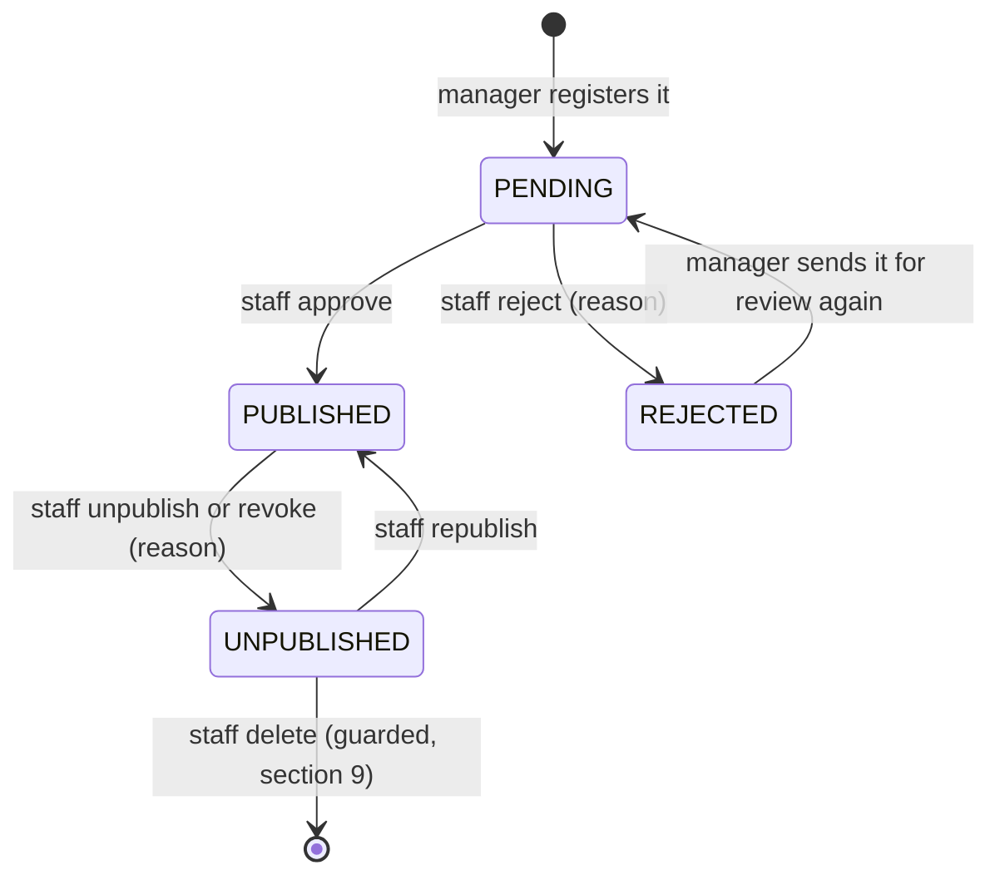

# 03. Organisation Module Design

Implements `docs/requirements/03. organizations.md`. Shared parts (users, policies, files, search, caching) are in `01. general_design.md`.

---

## 1. Storage approach

All four organisation types share one `Organisation` table. Type-specific fields are nullable columns, and lists live in child tables.

| Option | Why |
|---|---|
| One table plus child tables (chosen) | One shape for directories, and one foreign key target for offers, conversations and subscriptions. Only a few fields differ by type (registration number, level, institution kind, industry). |
| A base table plus one table per type | More joins and code for about five type-specific fields |
| A JSON column for type-specific fields | No constraints, and harder filtering on level and leagues |

A validation schema per type decides which fields apply and which are required (section 3).

## 2. Data model

```prisma
enum OrganisationType   { CLUB  UNION  INSTITUTION  BRAND }   // INSTITUTION = college or university, shown as "Colleges / Universities"
enum OrganisationStatus { DRAFT  PENDING  PUBLISHED  REJECTED  UNPUBLISHED  BANNED }  // BANNED reserved (ORG-12.1)
enum InstitutionKind    { COLLEGE  UNIVERSITY }

model Organisation {
  id          String @id @default(uuid(7)) @db.Uuid
  type        OrganisationType
  status      OrganisationStatus @default(PENDING)
  slug        String @unique                 // public URL: /clubs/{slug}
  name        String
  description String?                        // formatted text: bold, italic, lists and links only, cleaned on save
  logoFileId  String?

  officialEmail String?
  officialPhone String?                      // E.164
  website       String?
  foundedYear   Int?                         // 1800 to the current year

  addressLine1 String?
  addressLine2 String?
  city         String?
  region       String?
  postcode     String?
  country      String?  @db.Char(2)
  mapAddress   String?
  latitude     Decimal? @db.Decimal(9,6)
  longitude    Decimal? @db.Decimal(9,6)

  facebookUrl  String?
  linkedinUrl  String?
  instagramUrl String?
  xUrl         String?
  youtubeUrl   String?

  // Type-specific
  registrationNumber String?                 // clubs, unions, colleges/universities
  trainingGround     String?
  playingGround      String?
  previousResults    String?
  level              String?                 // clubs and unions
  institutionKind    InstitutionKind?        // colleges/universities
  industryId         String?                 // brands
  industryOther      String? @db.VarChar(60) // brands, when the industry is "other"

  documentFileId    String?                  // private File
  publishedAt       DateTime?
  statusReason      String?                  // reason for Rejected or Unpublished
  statusChangedById String?
  deletedAt         DateTime?                // tombstone (section 9)
  legacyId          String? @unique
}
```

### 2.1 Child tables and reference data

```prisma
enum Weekday { MON TUE WED THU FRI SAT SUN }

model Coach           { id String @id @default(uuid(7)) @db.Uuid  organisationId String  name String  photoFileId String?  jobRole String  startDate DateTime @db.Date  endDate DateTime? @db.Date  sortOrder Int }
model Season          { id String @id @default(uuid(7)) @db.Uuid  organisationId String  label String  startDate DateTime @db.Date  endDate DateTime @db.Date  sortOrder Int }
model TrainingSession { id String @id @default(uuid(7)) @db.Uuid  organisationId String  day Weekday  startTime String  endTime String  sortOrder Int }   // "HH:mm"
model League          { id String @id  name String  country String? @db.Char(2)  isActive Boolean @default(true)  sortOrder Int }   // id: stable slug
model OrganisationLeague { organisationId String  leagueId String  @@id([organisationId, leagueId]) }
model Industry        { id String @id  label String  isActive Boolean @default(true)  sortOrder Int }   // id: stable slug; includes "other"

// A club's partner college/university: a link when it is on the platform, free text when not (ORG-1.9)
model ClubPathway { id String @id @default(uuid(7)) @db.Uuid  organisationId String  institutionId String?  institutionText String?  sortOrder Int }
```

Left out for brevity in every model in this file: the standard `createdAt`, `updatedAt`, `createdById` and `updatedById` columns, and `@db.Uuid` on foreign keys (`01` design section 4). League and industry ids are stable slugs, like the reference data in `02` design section 1.1.

- **List entries:** required fields per entry follow ORG-3.1. Each end is checked to be after its start (ORG-3.2).
- **Training times:** stored as `HH:mm` in the organisation's local time. They describe a weekly schedule, so no time-zone conversion is needed.
- **Seeds:** the 18 starting leagues and the 20 industries from requirements `03` are seeded. Staff can edit both lists (ADM-11.1).

### 2.2 Memberships

```prisma
enum MembershipStatus { PENDING  ACTIVE  REJECTED  REMOVED }
enum MembershipSource { NEW_ORGANISATION  CLAIM }

model OrganisationMember {
  id             String @id @default(uuid(7)) @db.Uuid
  userId         String
  organisationId String
  status         MembershipStatus @default(PENDING)
  source         MembershipSource
  decidedById    String?
  decidedAt      DateTime?
  reason         String?
  @@index([organisationId, status])
}
```

- **One organisation per manager (GEN-1.3, ORG-1.2):** a partial unique index on `(userId) WHERE status IN ('PENDING','ACTIVE')` allows one current membership. Old memberships stay as history.
- **Joining:**
  - Registering a new organisation creates a `PENDING` organisation and a `PENDING` membership with source `NEW_ORGANISATION` (ORG-6.1).
  - Choosing an existing organisation creates a `PENDING` membership with source `CLAIM` (ORG-6.2).
  - In both cases the manager's identity document is reviewed in "Verify users". Approval sets the membership to `ACTIVE` (`05` ADM-6.4).
- **Verified manager:** the user is verified (email and document) and the membership is `ACTIVE`.
- **Several managers (ORG-1.3):** an organisation can have several memberships. Nobody can add, remove or approve managers except staff (ORG-1.5).
- **Notifications:** `managersToNotify(organisationId)` returns every verified manager. Every organisation email and in-app notification is sent through it (ORG-1.4).

## 3. Type rules

| Field | Club | Union | College/University | Brand |
|---|---|---|---|---|
| Name, logo, official email, official phone, one-line address | required | required | required | required |
| Website | optional | optional | optional | required |
| Founded year, address parts, country, social links, description, document | optional | optional | optional | optional |
| Registration number | required | required | required | – |
| Grounds, previous results, seasons, training days, coaches | optional | optional | optional | – |
| Leagues, level | optional | optional | – | – |
| Pathway college / university | optional | – | – | – |
| Institution kind | – | – | required | – |
| Industry (or "other" with text) | – | – | – | required |

- **Unused fields are refused:** a field that doesn't apply to the type is rejected, so stale values cannot be saved.
- **Labels:** the registration number is labelled "Union registration number" for clubs and unions, and "Registration number" for colleges/universities. Coach dates are labelled "Joining date" and "Leaving date" for colleges/universities. Brand addresses are labelled "Headquarters address". All of these are interface labels only.
- **Formats (ORG-2.1):** emails, URLs and phone numbers are validated. Phone numbers are stored in international (E.164) format.
- **"Other" industry (ORG-3.3):** the brand page shows `industryOther` as the industry. The directory filter groups every "other" brand under "Other".

## 4. Lifecycle and editing



- **Draft:** `DRAFT` exists for future use; no flow creates it now. Like `PENDING`, `REJECTED` and `UNPUBLISHED`, it is visible only to the organisation's managers and to staff (ORG-6.4).
- **`canEditOrganisation(viewer, org)`:**
  - **Pending or Rejected:** the manager who registered it (membership source `NEW_ORGANISATION`, membership `PENDING` or `ACTIVE`) can edit everything, even before being verified. Changes apply at once (ORG-7.1, ORG-4.2).
  - **Rejected:** the same manager can press "Send for review again", which returns it to Pending and creates a new verification request.
  - **Published:** only verified managers with an `ACTIVE` membership can edit.
  - **Staff:** can edit any field of any organisation, whatever its status. Their changes apply at once and are audited with old and new values (`05` ADM-8.2).

### 4.1 Sensitive changes (ORG-7.2, ORG-7.3)

```prisma
enum ChangeRequestStatus { PENDING  APPROVED  REJECTED  SUPERSEDED }

model OrganisationChangeRequest {
  id             String @id @default(uuid(7)) @db.Uuid
  organisationId String
  requestedById  String
  changes        Json                   // only: name, country, registrationNumber, documentFileId
  status         ChangeRequestStatus @default(PENDING)
  reason         String?
  decidedById    String?
  decidedAt      DateTime?
  @@index([organisationId, status])
}
```

- **Saving a Published organisation:** changes to sensitive fields go into a change request. All other fields are saved at once (ORG-7.4).
- **One pending request:** a new request supersedes an older pending one for the same organisation.
- **While waiting:** the public page keeps the approved values. Managers see "Changes awaiting review" with the new values.
- **Decision:**
  - Approval writes the values, refreshes the page cache and notifies the managers.
  - Rejection discards them and sends the reason.
- **New organisation document:** uploaded as a new file and swapped in only on approval. The old file is deleted then.

## 5. Managers leaving and the last verified manager

- **Leaving (ORG-1.6):** `removeOrganisationFromProfile(userId)` sets the membership to `REMOVED` and resets the user's `documentStatus` to `NONE`. It also tells the realtime server to stop the user's organisation-inbox events.
- **Joining another organisation (ORG-1.7):** a new membership and a new identity document, reviewed like a first registration.
- **At least one verified manager (ORG-1.8):** `assertNotLastVerifiedManager(orgId, userId)` runs in the same transaction as leaving, account deletion, staff removal, staff suspension and staff revocation.
  - It locks the organisation row (`SELECT … FOR UPDATE`) and counts the other verified managers.
  - If there are none, the action is refused with a message explaining the rule.
  - The lock stops two managers leaving at the same moment.
- **Rejected managers (`05` ADM-3.5):** a manager whose claim was rejected can upload a new document, choose another organisation, or register a new one. Each choice creates a new membership.

## 6. Adding an organisation and duplicates

- **Registration:** registering a manager and a new organisation happens in one transaction. It creates the user, the organisation (`PENDING`), the membership, the manager's identity verification request and the organisation's verification request. Staff are notified through the outbox (ORG-6.1, `05` ADM-4.10).
- **Duplicate check (ORG-6.3):** while adding, the system looks for organisations of the same type with a similar name (trigram similarity above 0.6) in the same country, or with the same normalised registration number (upper case, no spaces). The 0.6 threshold is a starting value, tuned against the migrated WordPress organisations before launch.
  - Matches are offered with "Claim this organisation instead". The manager can still continue.
  - Staff then see "possible duplicate" in the review list.
- **Duplicates found later (`05` ADM-8.4):** staff unpublish the duplicate record and cancel or refund its subscription. Records are never merged.

## 7. Geocoding (ORG-2.2)

- **When the address changes:** coordinates are cleared and a geocoding job is queued.
- **The job:** looks up the address with the Google Geocoding API (`01` design section 1), stores latitude and longitude, and refreshes the organisation's page cache.
- **The map:** shown with the Google Maps JavaScript API, only after the visitor accepts the Maps cookie category (`01` design section 14.3).
- **If it fails:** after retries the coordinates stay empty. The page hides the map, and the manager sees "We couldn't find this address on the map".
- **Offers:** each offer copies coordinates from its own location (`04` design).

## 8. Public pages, directories and the players section

- **URLs:** `/clubs/{slug}`, `/unions/{slug}`, `/colleges-universities/{slug}` and `/brands/{slug}`. The directories are `/clubs`, `/unions`, `/colleges-universities` and `/brands`.
  - The first part of the URL comes from a fixed map in code: `CLUB` → `/clubs`, `UNION` → `/unions`, `INSTITUTION` → `/colleges-universities`, `BRAND` → `/brands`. It is never stored.
  - The slug is stored on each organisation (`Organisation.slug`). It keeps URLs readable for people and search engines (ORG-9.1), and lets the WordPress addresses redirect one-to-one.
  - Slugs come from the name only, with a number added if one is already taken.
  - **College or university:** `institutionKind` (`COLLEGE` or `UNIVERSITY`) is required for `INSTITUTION` organisations and refused for other types. The page and card show "College" or "University", and the directory can filter on it. The WordPress `type` field maps to it directly.
  - A rename keeps the old slug as a permanent redirect.
- **Organisation page (ORG-9.1 to ORG-9.6):**
  - Public and indexable only while `PUBLISHED`. Any other status returns 404 to the public.
  - Cached with the tag `org:{id}`. The tag is refreshed when the organisation, its coaches, seasons, training sessions, leagues, pathways or offers change.
  - Includes structured data (`SportsOrganization` or `Organization`) and is listed in the sitemap.
  - Shows public fields, the map, open offers with "View all offers", and coaches, training days and season layout. Empty sections show their "not provided" text.
  - The "Message" button and the players section are small dynamic components inside the cached page.
- **Players section (ORG-9.4, ORG-9.5):**
  - Lists listed players whose `currentClubId`, `currentUnionId` or `currentInstitutionId` is this organisation. Free-text names never match.
  - Uses `canViewPlayers(viewer)`: it shows the list, "Login to view" or "Subscribe to view".
- **Directories (ORG-8.1 to ORG-8.5):**
  - Login is required. Only `PUBLISHED` organisations not deleted are listed, with or without a subscription.
  - Search is by name only. Sorting is by name or newest.
  - Filters: league, level and country for clubs and unions; institution kind and country for colleges/universities; industry and country for brands.
  - "Has active offer" is an `EXISTS` sub-query on `Offer` with `status = PUBLISHED AND expiresAt > now()`.
  - Paging: infinite loading, 24 cards at a time (`01` design section 11).
  - Indexes: `(type, status, name)`, trigram on `name`, `(type, status, country)`, `OrganisationLeague(leagueId)`, `(industryId)`, and `Offer(organisationId, status, expiresAt)`.
- **Card:** logo (placeholder when missing), name, type, country and city.

## 9. Unpublishing, deleting and tombstones

- **Unpublish (`05` ADM-8.5, ADM-8.6):** sets `UNPUBLISHED` with `statusReason`.
  - The public page, directory entry and offers disappear for everyone except the organisation's managers and staff.
  - The subscription is paused (`06` design).
  - Republishing returns it to `PUBLISHED` and resumes the subscription.
- **Delete (`05` ADM-8.7, `06` SUB-8.8):** `deleteOrganisation(orgId)` runs in one transaction. It locks the row and refuses unless all of these are true:
  - the status is `UNPUBLISHED`
  - there is no subscription that is not cancelled
  - there are no offers and no applications

  It then:
  1. sets every membership to `REMOVED`, so the managers are asked to choose or register an organisation (ORG-4.2)
  2. deletes child rows and files
  3. clears the public fields, keeping only the name for billing history, and sets `deletedAt`
  4. writes an audit event
- **After deletion:** conversations with the organisation stay, shown as "Deleted organisation". Payments and subscriptions stay for 6 years (SUB-10.2).
- **Deleted unverified manager (GEN-3.11):** `deleteAccount` deletes the organisation the manager registered if it is not `PUBLISHED`. Because such an organisation never had offers or a paid subscription, the same delete steps apply without the Unpublished condition.

## 10. Manager capabilities (ORG section 10)

| Capability | Policy |
|---|---|
| Edit the organisation | `canEditOrganisation` (section 4) |
| Edit own profile | Signed in |
| Messages and the organisation inbox | Verified manager (`04` design) |
| Players directory and profiles | Verified manager and active subscription |
| Manage offers | Verified manager and active subscription |
| View applications and change their status | Verified manager and active subscription |
| Subscription page | `ACTIVE` membership; buying needs a Published organisation (SUB-4.1) |

Without an active subscription, the gated sections show an upgrade message and everything else keeps working (ORG-10.1).

## 11. Requirement coverage

| Requirement | Design element |
|---|---|
| ORG-1.1 | `OrganisationStatus` (2, 4) |
| ORG-1.2 to ORG-1.8 | Memberships (2.2), leaving and the last verified manager (5) |
| ORG-1.9 | `ClubPathway` (2.1) |
| ORG-2.x, ORG-3.x, sections 2 and 3 | `Organisation` columns, child tables, type rules (2, 3) |
| ORG-4.1, ORG-4.2 | `canEditOrganisation`, membership status (4, 2.2) |
| ORG-5.1, ORG-5.2 | `League`, `OrganisationLeague` (2.1) |
| ORG-6.1 to ORG-6.4 | Registration, duplicate check, visibility (6, 4) |
| ORG-7.1 to ORG-7.4 | Editing rules and change requests (4, 4.1) |
| ORG-8.1 to ORG-8.5 | Directories (8) |
| ORG-9.1 to ORG-9.6 | Organisation page and players section (8) |
| ORG-10.1 | Capabilities (10) |
| ORG-11.1 to ORG-11.3 | Verification in `05` design |
| ORG-12.1 | `BANNED` reserved in the enum |

## 12. Design questions

None at the moment.
