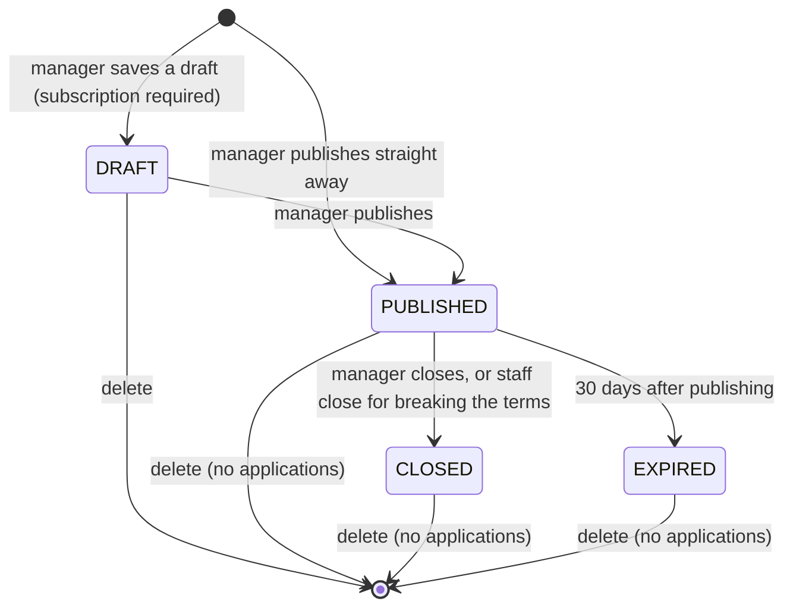
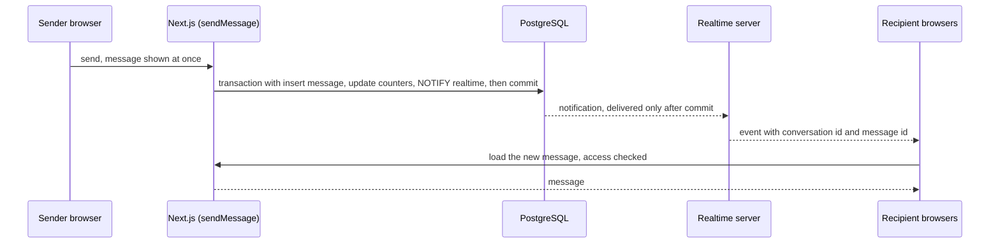

# 04. Offers, Applications and Messaging Design

Implements `docs/requirements/04. offers_and_applications.md`. Shared parts are in `01. general_design.md`.

---

## 1. Offers

### 1.1 Data model

```prisma
enum OfferStatus { DRAFT  PENDING  PUBLISHED  CLOSED  EXPIRED }   // PENDING reserved for a later approval step
enum PaidStatus  { PAID  UNPAID }

model Offer {
  id              String @id @default(uuid(7)) @db.Uuid
  organisationId  String
  offeredBy       OrganisationType            // copied from the organisation at creation
  title           String? @db.VarChar(150)    // required to publish; may be empty in a draft
  description     String?                     // formatted text: bold, italic, lists and links only, cleaned on save; max 5,000 visible characters; required to publish
  paid            PaidStatus?                 // required to publish
  locationText    String?                     // one-line address; defaults to the organisation's address
  locationPlaceId String?                     // Google place id; defaults to the organisation's placeId (`03` design section 7)
  status          OfferStatus @default(DRAFT)
  publishedAt     DateTime?                   // set when published; null while DRAFT or PENDING
  expiresAt       DateTime?                   // publishedAt + 30 days, never changed (OFF-1.4); null until published
  expiryReminderSentAt DateTime?
  closedAt        DateTime?
  closedByStaffId String?                     // set when staff close it for breaking the terms (05 ADM-9.1)
  closedReason    String?
  copiedFromId    String?                     // the offer it was copied from (OFF-1.13)
  legacyId        String? @unique

  positions    OfferPosition[]
  skills       OfferSkill[]
  applications Application[]

  @@index([status, expiresAt])
  @@index([organisationId, status, expiresAt])
  @@index([offeredBy, status])
}

model OfferPosition { offerId String  positionId String  @@id([offerId, positionId]) }
model OfferSkill    { offerId String  skillId String     @@id([offerId, skillId]) }
```

Left out for brevity in every model in this file: the standard `createdAt`, `updatedAt`, `createdById` and `updatedById` columns, and `@db.Uuid` on foreign keys (`01` design section 4). An offer's `createdById` is the manager who created it. `Message` is append-only, so it has `createdAt` and `createdById` only.

- **Relation fields:** `positions`, `skills` and `applications` are Prisma relation fields, not database columns. Nothing is stored in the `Offer` table for them; the link lives in `OfferPosition`, `OfferSkill` and `Application.offerId`. Prisma needs both sides of a relation declared, and the field lets code load an offer's applications or count them (`_count`) in one query.
- **Required fields:** title, description and paid/unpaid can be empty in a draft. A database check constraint requires them, plus `publishedAt` and `expiresAt`, whenever the status is not `DRAFT` or `PENDING`.
- **Offered by:** stored at creation, not looked up when shown, so an offer keeps its label even if the organisation changes later.
- **Positions and skills:** both are optional and can have several values each. They point at the reference tables (`02` design).

### 1.2 Lifecycle



- **Drafts (OFF-1.14):** "Save draft" stores the offer as `DRAFT` with whatever is filled in. Drafts are visible only in the managers' offers section, never in the directory, on the organisation page or to staff moderation, and take no applications. Saving and deleting a draft need `canManageOffers`, like any other offer change (SUB-3.1).
- **Pending:** `PENDING` is reserved for a later approval step. No flow sets it in the first release. When it is used, a pending offer will be visible only to its managers and staff, like a draft.
- **Creating (OFF-1.7):** the service fills in the organisation, `offeredBy` and the default location when the offer is created. Publishing sets `publishedAt = now()` and `expiresAt = publishedAt + 30 days`. The location copies the organisation's `mapAddress` and `placeId`. The manager can pick another place with the same address field as organisations (`03` design section 7). Title, description and paid/unpaid are required to publish (OFF-1.8).
- **Editing (OFF-1.4, OFF-1.10):** allowed while the status is `DRAFT`, `PENDING` or `PUBLISHED`, that is, not `CLOSED` or `EXPIRED`. Editing a published offer never changes `expiresAt`. Closed and Expired offers cannot be edited, reopened or republished.
- **Closing (OFF-1.11):** sets `CLOSED` and `closedAt`. The offer leaves the directory and stops taking applications.
- **Deleting (OFF-1.12):** refused if any application exists. The count is checked inside the same transaction, and the manager is told to close the offer instead.
- **Copy as new offer (OFF-1.13):**
  - `copyOffer(offerId)` creates a new `DRAFT` offer with the old offer's title, description, paid, positions, skills and location, and `copiedFromId` set. The manager is taken to edit it.
  - The copy is a separate offer with no applications. Publishing it gives it a new `publishedAt` and a new 30-day expiry.
  - Earlier applicants can apply again, because applications are unique per offer.
  - Copying is not offered for offers that staff closed (`05` ADM-9.2).
- **Expiry job, hourly (OFF-1.5, NOT-1.1):**
  - Sets offers whose `expiresAt` has passed to `EXPIRED` and queues "offer expired" notifications.
  - Sends "expires in 3 days" once per offer, recorded in `expiryReminderSentAt`.
  - Directory queries also filter on `expiresAt > now()`, so an offer disappears on time even if the job runs late.

### 1.3 Access

- **Managing offers:** `canManageOffers(viewer, org)` requires an active membership, a verified manager and an active subscription (OFF-1.1, OFF-1.2).
  - Only managers create offers (OFF-1.9).
  - Staff can only close an offer with a reason (`05` ADM-9.1). There is no other staff code path for offers.
- **Subscription ends (OFF-1.3):** nothing happens to the organisation's offers. Published offers stay visible until they expire.
- **Organisation not Published:** its offers are hidden from players, because every offer query joins on `organisation.status = PUBLISHED` (`05` ADM-8.6).
- **Managers' offers section (OFF-1.6):** lists the organisation's offers in every status, with expiry date and number of applications. The count is not gated by subscription. Staff closures show "Closed by Offload" with the reason.

### 1.4 Offers directory and offer page

- **Access:** login required (OFF-2.1). The base condition is `status = PUBLISHED AND expiresAt > now() AND organisation.status = PUBLISHED`. The default sort is newest first (OFF-2.2).
- **Filters (OFF-2.3):**
  - Search: trigram match on the title only.
  - Organisation type: `offeredBy IN (...)`.
  - Published date range.
  - Positions and required skills: match any, using `EXISTS` on the join tables.
  - One organisation.
  - Paid or unpaid.
- **Offer page (OFF-2.4):** title, organisation with link and logo, offered by, paid or unpaid, positions, required skills, location with map, expiry date and description.
- **Apply button (OFF-2.6):**
  - Shown when `canApply(viewer, offer)` is true.
  - If the player has an application that isn't withdrawn, the page shows "Applied" and the current status instead.
- **On organisation pages (OFF-2.5):** the organisation's open offers appear on its page.

## 2. Applications

### 2.1 Data model

```prisma
enum ApplicationStatus { SUBMITTED  SHORTLISTED  CONTACTED  REJECTED  WITHDRAWN }

model Application {
  id                String @id @default(uuid(7)) @db.Uuid
  offerId           String
  playerId          String                    // PlayerProfile
  organisationId    String                    // copied from the offer, for fast manager queries
  note              String? @db.VarChar(2000)
  status            ApplicationStatus @default(SUBMITTED)
  statusChangedAt   DateTime?
  statusChangedById String?
  resubmittedAt     DateTime?                 // set when a withdrawn application is submitted again
  legacyId          String? @unique

  @@unique([offerId, playerId])
  @@index([organisationId, createdAt])
  @@index([playerId, createdAt])
}
```

### 2.2 Applying, withdrawing and re-applying

- **Applying (APP-1.1 to APP-1.4):**
  - `applyToOffer(offerId, note)` checks `canApply` again, then inserts in a transaction. No subscription is ever needed to apply.
  - If a row already exists:
    - status `WITHDRAWN`: the row is set back to `SUBMITTED`, with the new note and `resubmittedAt` set (APP-1.9)
    - any other status: the player sees "You have already applied" (APP-1.2)
  - Two submits at the same moment end in a unique-key error, handled as "already applied".
- **Notifying managers:** every verified manager is notified by email and in the app (`managersToNotify`).
  - Without an active subscription, the notification has a "Subscribe to view" link and no applicant details (APP-1.1).
- **Withdrawing (APP-1.9):** allowed at any time, whatever the status. The status becomes `WITHDRAWN`.
- **Suspension and deletion of a player (`05` ADM-7.3, ADM-7.5):** the player's open applications are withdrawn. "Open" means `SUBMITTED`, `SHORTLISTED` or `CONTACTED`. After deletion, the applications show "Deleted user".

### 2.3 Manager and player views

- **Manager view (APP-1.5, APP-1.6, APP-1.10):**
  - `/dashboard/applications`, filtered by offer and status, paged.
  - Requires `canViewApplications`. Without a subscription the page shows "Subscribe to view applications".
  - Shows the player's name and photo, primary position, current club, date, note, status and a profile link.
  - The profile link goes to the normal player profile, so the subscription gate applies there too. There is no separate applicant view.
  - Managers change the status to Shortlisted, Contacted or Rejected by hand. Nothing changes the status automatically.
  - Each status change notifies the player by email and in the app (APP-1.7).
- **Player view (APP-1.8):** `/dashboard/applications` lists the player's applications with offer, organisation, date and status, plus "Withdraw" and, where allowed, "Apply again".

## 3. Messaging

### 3.1 Model

A conversation is always between exactly two **parties**. A party is a user (a player, manager or staff member writing personally) or an organisation.

```prisma
enum PartyKind { USER  ORGANISATION }

model Conversation {
  id            String @id @default(uuid(7)) @db.Uuid
  pairKey       String @unique                // sorted "U:{id}" / "O:{id}" keys of both parties
  lastMessageAt DateTime
  parties       ConversationParty[]
  messages      Message[]
}

model ConversationParty {
  id             String @id @default(uuid(7)) @db.Uuid
  conversationId String
  kind           PartyKind
  userId         String?
  organisationId String?
  lastReadAt     DateTime?                    // read state per party (MSG-1.9)
  unreadCount    Int @default(0)
  @@index([userId])
  @@index([organisationId])
}

model Message {
  id             String @id @default(uuid(7)) @db.Uuid
  conversationId String
  senderUserId   String                       // the person who wrote it (a tombstone after deletion)
  senderOrgId    String?                      // set when a manager writes from the organisation inbox
  body           String @db.VarChar(2000)
  legacyId       String? @unique
  @@index([conversationId, createdAt])
}
```

- **One conversation per pair:** `pairKey` makes sure two parties have one conversation, and lets "find or create" run as one database statement.
- **Writing as the organisation (MSG-1.5):** a manager writing from the organisation inbox sends as the organisation party, and `senderUserId` records which manager wrote it. Every manager sees the whole conversation.
- **Messages to an organisation (MSG-1.4):** they go to the organisation party. Every manager can open the organisation inbox, and every verified manager receives a copy of the notification.
- **Reading (MSG-1.9):** read state is kept per party and shared by all managers, so one manager reading marks the conversation read for the whole organisation.
- **Staff (`05` ADM-4.8, ADM-4.9):** staff write only as user parties. They can open only their own conversations, never other users' or organisations' conversations (ADM-4.6).
- **Deleted users and organisations (MSG-1.12, `05` ADM-8.7):** messages stay, and the name shows as "Deleted user" or "Deleted organisation" (tombstones, `01` design section 4).
- **No editing or deleting (MSG-1.16):** there are no update or delete actions for messages or conversations. The application's database role has no `UPDATE` or `DELETE` permission on `Message`.

### 3.2 Sending

`sendMessage(target, body)` runs these steps:
1. **Check the sender:** `canMessage(viewer)` requires a verified user or staff member who is not suspended (MSG-1.1, GEN-5.5).
2. **Check the recipient:** a suspended or deleted recipient cannot receive new messages (`05` ADM-7.3).
3. **Rate limit (MSG-1.10):** 30 messages per hour and 200 per day per user.
4. **Length (MSG-1.7):** after trimming, the body must be between 1 and 2,000 characters.
5. **Save, in one transaction:** find or create the conversation, insert the message, add 1 to the other party's `unreadCount`, update `lastMessageAt`, queue the notification and the email, and publish a real-time event (section 3.4).

Message bodies are plain text, shown with HTML escaping and automatic `http(s)` links. No HTML is allowed. Messaging never requires a subscription (MSG-1.2).

### 3.3 Reading

- **Layout (MSG-1.6):** a two-pane page, with the conversation list next to the open thread on desktop and two screens on mobile.
- **Conversation list:** ordered by `lastMessageAt`. Each row shows the other party's name and photo or logo, a preview of the last message, its date and an unread marker.
- **Managers:** a Personal / Organisation switch (`?box=personal|organisation`). Each side shows the conversations of one party, with its own unread total.
- **Thread:** sent and received messages in date order, the latest 50 first and older ones on demand, with a reply box. There is no separate sent view.
- **Opening a thread:** sets `lastReadAt` and resets `unreadCount` for the viewer's party.

### 3.4 Real-time delivery

Messages must reach an open browser within 2 seconds (MSG-1.13). The server pushes events over our own WebSocket connection (`wss://`), using only open-source libraries.



- **Separate process:** Route Handlers cannot hold WebSocket connections, so the realtime server is a small Node.js process using the `ws` library, run as the `realtime` Compose service. The proxy routes `wss://{domain}/ws` to it (`01` design section 16).
- **Authentication:** on connect, the server reads the `session` cookie and looks it up in the `Session` table with a read-only database role. It also checks the `Origin` header.
- **Channels:** the server subscribes the connection to the user's own channel and, for a manager, the organisation's channel. These are the same parties as `inboxPartiesFor`. Staff get only their own channel.
- **Fan-out:** Next.js runs `NOTIFY realtime, '<json>'` in the transaction that saves the message.
  - PostgreSQL delivers it to every listening realtime server only after the commit, so no event is ever sent for a message that was rolled back.
  - Each realtime server runs `LISTEN realtime` and forwards events to its own connections, so several servers can run without Redis.
- **Event contents:** ids only, which stays well under PostgreSQL's 8,000-byte limit. The browser loads the message through the normal access checks, so message text never travels over the socket.
- **Events:** `message.created`, `conversation.read` (updates unread counts in other tabs and on other devices), `notification.created` (the notification bell), and `session.revoked` and `membership.changed` (close or re-check affected connections).
- **Sent messages (MSG-1.13):** the sender sees their message at once (optimistic display), then the saved version replaces it.
- **Connection loss (MSG-1.14):**
  - The server pings every 30 seconds and drops connections that miss two replies.
  - The browser reconnects with growing delays (1, 2, 5, 10 and 30 seconds) and shows "Reconnecting…" meanwhile.
  - After reconnecting it loads any messages newer than the last one it has.
- **Limits:** at most 10 connections per user. Browsers only receive on the socket. Sending always goes through the Server Action and its rate limit.

### 3.5 Message emails

- **Content (MSG-1.8):** sent with an SMTP2GO template (`01` design section 9). The platform passes the template id and its variables: the recipient's first name, the sender's display name and the link to the conversation. The message text and contact details are never passed, so they can never appear in the email.
- **Grouping:** at most one email per conversation and recipient every 15 minutes.
- **Skipped when read live (MSG-1.15):** the email is skipped when the recipient party's `lastReadAt` is later than the message, because the recipient had the thread open.

## 4. Notifications (NOT-1.1)

| Event | Produced by | Recipients | Channels |
|---|---|---|---|
| New application | `applyToOffer` | Verified managers (subscribe-to-view version when not subscribed) | In-app, email |
| Application status changed | `setApplicationStatus` | The player | In-app, email |
| New message | `sendMessage` | The other party (every verified manager for an organisation) | In-app, email (section 3.5) |
| Offer expires in 3 days | Expiry job | Verified managers | In-app, email |
| Offer expired | Expiry job | Verified managers | In-app, email |
| Offer closed by Offload | `05` ADM-9.1 | Verified managers | In-app, email |

## 5. Requirement coverage

| Requirement | Design element |
|---|---|
| Section 1.1, OFF-1.4, OFF-1.7, OFF-1.8 | `Offer` model and creation rules (1.1, 1.2) |
| OFF-1.1 to OFF-1.3, OFF-1.9 | Access (1.3) |
| OFF-1.5, OFF-1.10 to OFF-1.14 | Lifecycle, drafts, expiry job, delete rule, copy (1.2) |
| OFF-1.6 | Managers' offers section (1.3) |
| OFF-2.1 to OFF-2.6 | Directory and offer page (1.4) |
| APP-1.1 to APP-1.10 | `Application` model, apply and re-apply, views (2) |
| MSG-1.1 to MSG-1.12, MSG-1.16 | Party model, sending, reading, deleted parties (3.1 to 3.3) |
| MSG-1.13 to MSG-1.15 | Real-time delivery and message emails (3.4, 3.5) |
| NOT-1.1 | Notifications (4) |

## 6. Design questions

None at the moment.
